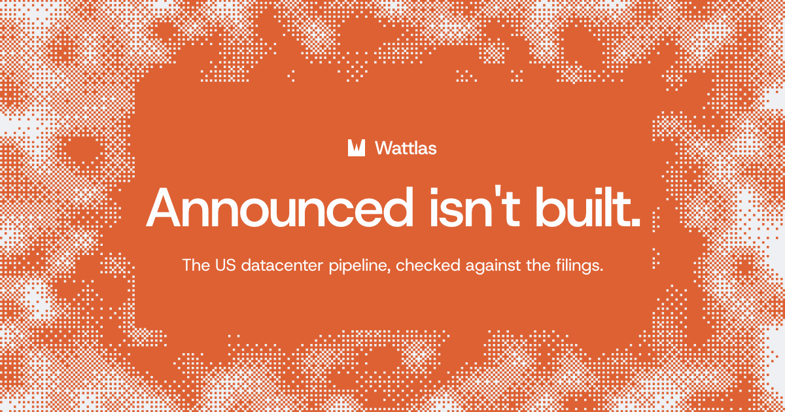

  

<h1 align="center">Wattlas</h1>

  <strong>US data center project intelligence, tied to public records.</strong> 
  Track planned and under-construction campuses from announcement through zoning, permits, and construction — with every stage backed by an official filing.

  <a href="https://wattlas.io">Website</a> ·
  <a href="https://wattlas.io/projects">Pipeline Directory</a> ·
  <a href="https://wattlas.io/metros">34 US Markets</a> ·
  <a href="https://wattlas.io/opposition">Moratoria &amp; Opposition</a> ·
  <a href="https://wattlas.io/jobs">Jobs</a> ·
  <a href="https://wattlas.io/sample">Sample Records</a> ·
  <a href="https://wattlas.io/articles">Guides</a>

---

## What Wattlas is

[Wattlas](https://wattlas.io) is a US-only tracker of data center projects that are not open yet: announced, zoning filed, zoning approved, site permit, building permit, and under construction. Every project in the pipeline is linked to at least one official public record (permits, zoning cases, utility and regulatory filings, state incentive agreements, or corporate filings). Press releases and third-party tracker listings alone never advance a project's stage.

Built for sales and business development teams selling into data center construction (generators, switchgear, cooling, electrical and mechanical contractors, engineering firms, land and power brokers), as well as grid analysts, developers, utilities, journalists, and researchers. Published, self-serve pricing — no sales call required. Inspect full unlocked records on the [sample page](https://wattlas.io/sample).

---

## Open repositories

| Repository | Description | Language / Format |
| --- | --- | --- |
| [`awesome-data-centers`](https://github.com/WattlasIO/awesome-data-centers) | Curated directory of data center infrastructure, grid interconnection, standards, open-source DCIM tools, energy research, and public resources. | Markdown |
| [`datacenter-permit-sources`](https://github.com/WattlasIO/datacenter-permit-sources) | Machine-readable directory and zero-dependency Python CLI for official US public filing portals, with explicit scope and caveat rules. | Python / JSON |
| [`datacenter-mw-calculator`](https://github.com/WattlasIO/datacenter-mw-calculator) | Zero-dependency engineering CLI & library converting IT load, utility load (PUE), water usage (WUE), substation MVA, and N+1 / 2N backup generator counts. | Python |
| [`datacenter-stage-spec`](https://github.com/WattlasIO/datacenter-stage-spec) | Open JSON Schema, stage taxonomy, and record-verification spec for distinguishing announced data centers from permitted and active construction. | JSON Schema / Python |

---

## Free public trackers on wattlas.io

| Hub | What it covers |
| --- | --- |
| [US Data Center Pipeline (`wattlas.io/projects`)](https://wattlas.io/projects) | Searchable public directory of planned, under-construction, operating, and reported US data center campuses by state, county, and owner. |
| [US Data Center Markets (`wattlas.io/metros`)](https://wattlas.io/metros) | Power-market and pipeline profiles across 34 US data center metros, including water stress and local moratoria context. |
| [Moratoria &amp; Local Opposition (`wattlas.io/opposition`)](https://wattlas.io/opposition) | Searchable index of city and county data center moratoria, public petitions, and local opposition threads across US states. |
| [US Data Center Jobs (`wattlas.io/jobs`)](https://wattlas.io/jobs) | Open US data center construction, engineering, and operations roles refreshed weekly by state, city, and employer. |
| [Sample Records (`wattlas.io/sample`)](https://wattlas.io/sample) | Full unlocked examples showing filing-backed stages, capacity disclosure basis, and site-level context before subscribing. |

---

## Record-reading guides

- [Announced isn't built: reading a datacenter's stage from the record](https://wattlas.io/articles/announced-isnt-built)
- [Data center megawatts: IT load vs utility load](https://wattlas.io/articles/data-center-megawatts-explained)
- [Phantom data centers: the record test](https://wattlas.io/articles/phantom-data-centers-record-test)
- [Large load interconnection: definitions and the six steps](https://wattlas.io/articles/what-is-a-large-load-interconnection)
- [Data center site permit vs building permit: the differences](https://wattlas.io/articles/data-center-site-permit-vs-building-permit)

---

## Official links

- **Website:** [wattlas.io](https://wattlas.io)
- **LinkedIn:** [linkedin.com/company/wattlas-io](https://www.linkedin.com/company/wattlas-io/)
- **Product demo:** [youtu.be/CDjQn-ceNhc](https://youtu.be/CDjQn-ceNhc)
- **Machine-readable index:** [wattlas.io/llms.txt](https://wattlas.io/llms.txt)
- **Contact &amp; corrections:** [hello@wattlas.io](mailto:hello@wattlas.io) · [Data removal / correction](https://wattlas.io/removal)
